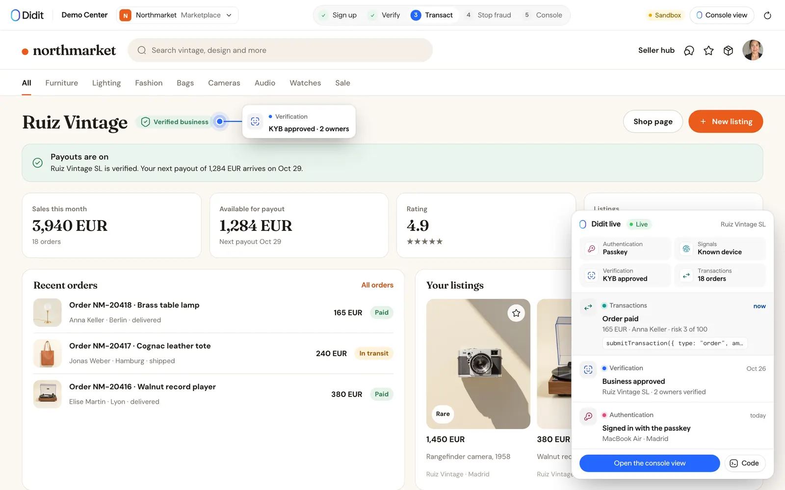
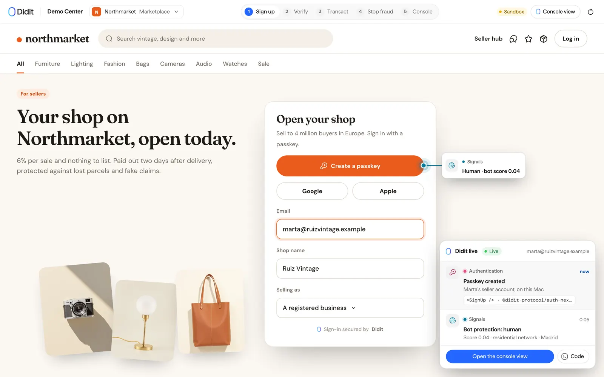
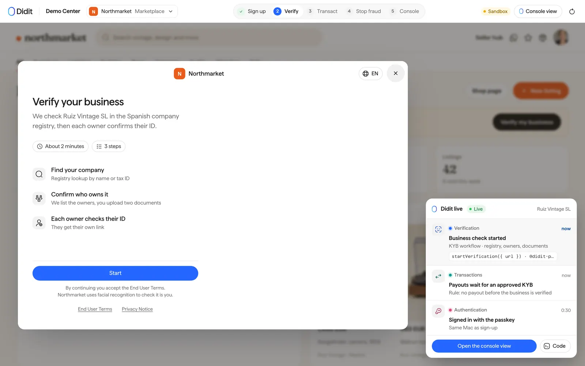
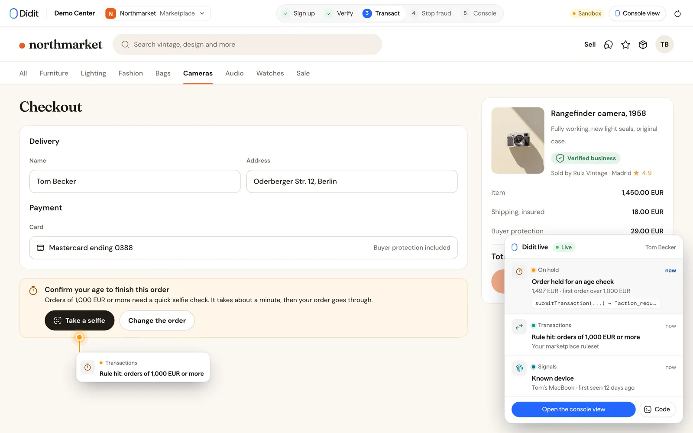
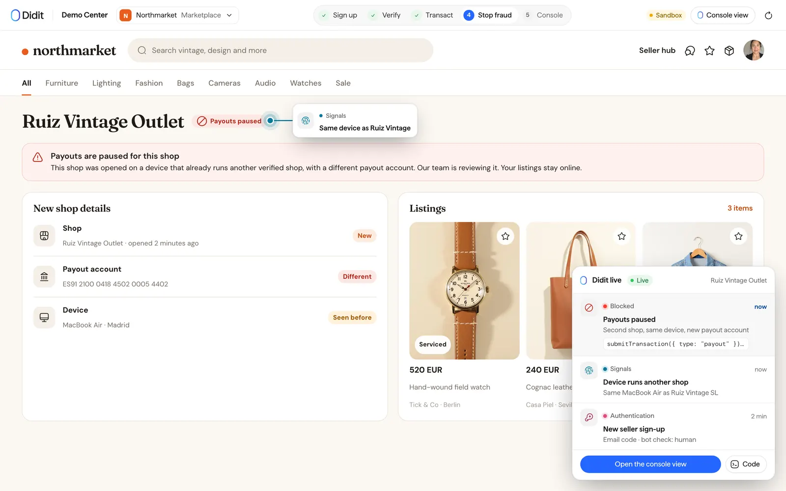
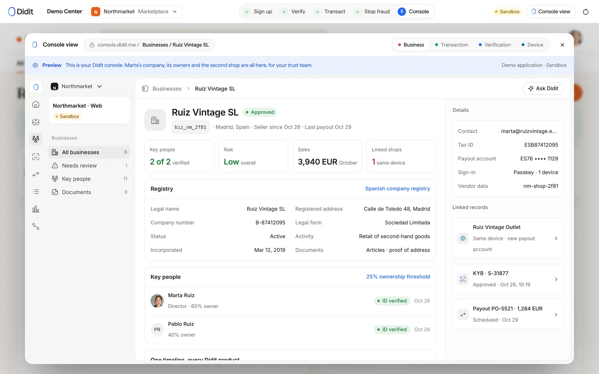
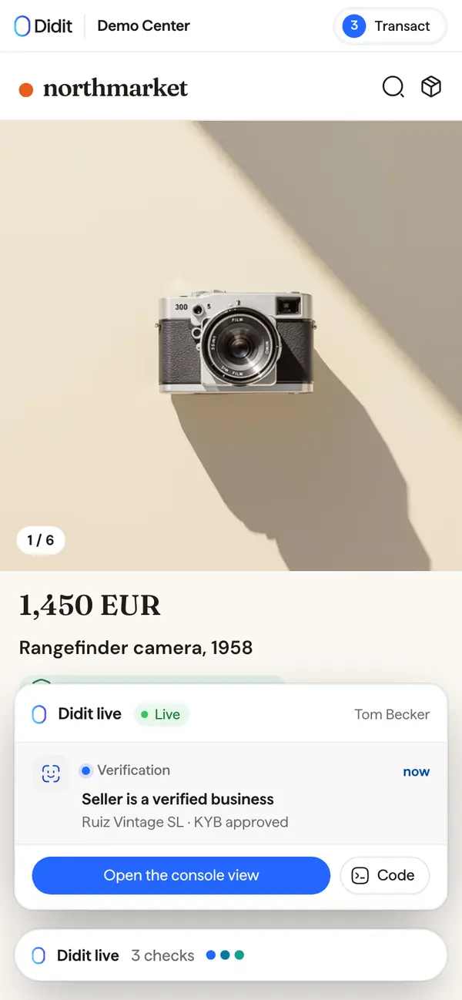
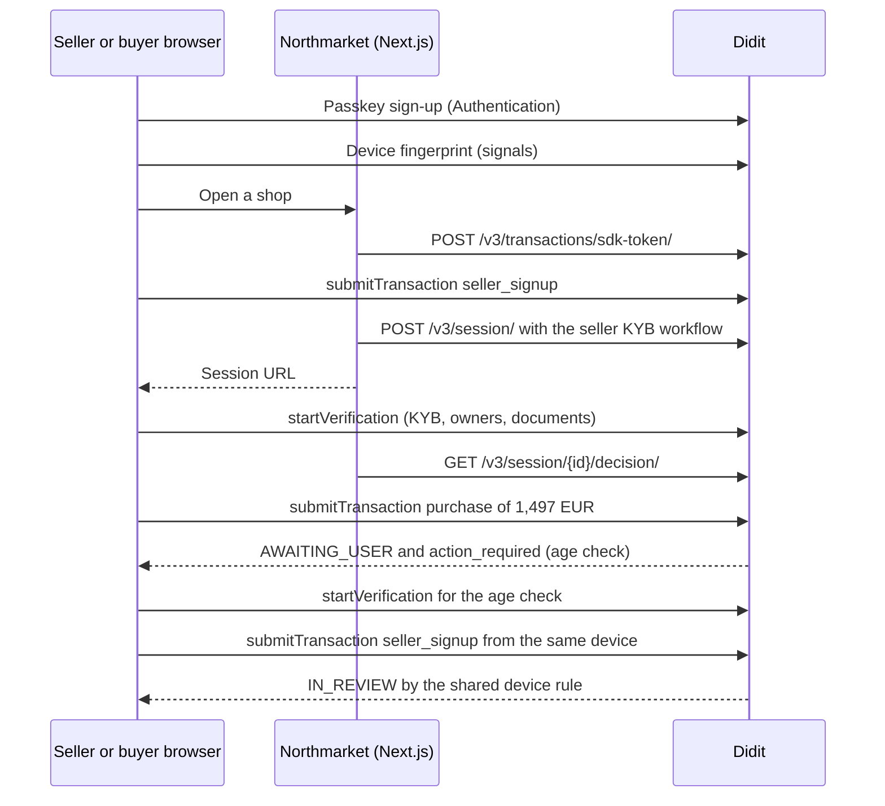

# Marketplace seller verification (KYB), buyer age checks and duplicate shop detection with Didit (Next.js)

**Northmarket is an open-source Next.js reference app for a resale marketplace that uses Didit for passkey seller sign-up, know your business (KYB) checks with each owner's ID before the first payout, an age check on high-value orders, and device signals that pause a second shop opened from the same device.**
It is for engineers and trust and safety teams at marketplaces and ecommerce platforms who want to see seller onboarding, order risk checks and fraud signals in one working flow.
Every Didit call is real code you can read, run against your own Didit application and copy into your product.
The marketplace is fictional, the integration is not.



Topics: `marketplace`, `kyb`, `know-your-business`, `seller-verification`, `age-verification`, `ecommerce`, `identity-verification`, `ubo`, `fraud-prevention`, `transaction-monitoring`, `nextjs`, `typescript`, `didit`, `reference-implementation`.

## What it shows

The app walks through five steps.
Each step names the Didit product and the call that does the work.

### 1. Open a shop with a passkey (Didit Authentication)

A seller opens a shop in the marketplace's own page.
Passkey comes first, with Google, Apple and an email code as fallbacks.
The app wraps the page in `<DiditAuth>` from `@didit-protocol/auth-nextjs` and lets `diditAuthProxy` serve the sign-up, callback and session routes.
The sign-up itself is submitted as a monitored transaction, so the device is recorded from the first minute.



From `middleware.ts` (lines 11-26):

```ts
const proxy = publishableKey()
  ? diditAuthProxy(
      { afterSignOutUrl: "/" },
      {
        DIDIT_PUBLISHABLE_KEY: publishableKey() ?? undefined,
        DIDIT_REDIRECT_URI:
          process.env.DIDIT_REDIRECT_URI?.trim() ||
          `${diditUrls.site}/auth/callback`,
        DIDIT_SESSION_CACHE_SECONDS: process.env.DIDIT_SESSION_CACHE_SECONDS,
      },
    )
  : null;

export default function middleware(request: NextRequest) {
  return proxy ? proxy(request) : NextResponse.next();
}
```

Without a publishable key the app falls back to its own form and a signed state cookie.

### 2. KYB before the first payout (Didit business verification)

The server creates a Didit session for the shop with the seller KYB workflow.
The workflow looks the company up in the registry, finds its owners, asks each key person for an ID check and collects company documents.
The browser opens the returned URL in the web SDK modal, and payouts stay locked until Didit approves the business.



From `lib/marketplace/server.ts` (lines 613-628):

```ts
const created = await didit(env, "POST", "/v3/session/", {
  workflow_id: env.workflows.kyb,
  vendor_data: seller.id,
  callback: `${origin}/`,
  callback_method: "both",
  language: options.language,
  metadata: { demo_app: DEMO_APP, shop: seller.shop },
  expected_details: {
    company_name: seller.company,
    ...(seller.country ? { registry_country: seller.country } : {}),
  },
});

if (
  !created.ok ||
  !isRecord(created.data) ||
```

From `lib/marketplace/setup.ts` (lines 34-67):

```ts
export function kybWorkflowDefinition(
  countries: string[],
  personWorkflowUuid: string,
) {
  return {
    workflow_label: KYB_WORKFLOW_LABEL,
    status: "published",
    features: [
      {
        feature: "KYB_REGISTRY",
        config: {
          kyb_registry_countries_config: Object.fromEntries(
            countries.map((code) => [code, { enabled: true, tier: "ubo" }]),
          ),
        },
      },
      {
        feature: "KYB_KEY_PEOPLE",
        config: {
          kyb_key_people_prefill_from_registry: true,
          kyb_require_officer_kyc: true,
          kyb_officer_verification_workflow: personWorkflowUuid,
          kyb_require_ubo_kyc: true,
          kyb_ubo_verification_workflow: personWorkflowUuid,
          kyb_shareholder_verification_workflow: personWorkflowUuid,
          kyb_ubo_ownership_threshold: 25,
          kyb_reuse_verified_individuals: true,
        },
      },
      {
        feature: "KYB_DOCUMENTS",
        config: { kyb_required_document_groups: ["LEGAL_PRESENCE"] },
      },
    ],
```

### 3. A large order waits for a buyer age check (Didit Transaction Monitoring)

Each order is submitted from the browser with `submitTransaction`, with a short-lived token the server mints for the buyer.
A rule holds an order of 1,000 EUR or more with `AWAITING_USER` and the age check workflow.
Didit returns an `action_required` URL and the browser opens it in the web SDK.



From `lib/marketplace/setup.ts` (lines 133-156):

```ts
{
  title: RULE_TITLES.highValue,
  description: `Orders of EUR ${HIGH_VALUE_THRESHOLD.toLocaleString("en")} or more wait until the buyer passes an age check.`,
  category: "finance",
  evaluation_mode: "ALL",
  scope: {
    transaction_types: ["finance"],
    directions: ["INBOUND"],
    action_types: [ACTIONS.purchase],
  },
  conditions: [
    demoOnly,
    { field: "currency", operator: "eq", value: "EUR" },
    { field: "amount", operator: "gte", value: HIGH_VALUE_THRESHOLD },
  ],
  aggregation: [],
  actions: [
    {
      type: "change_status",
      value: "AWAITING_USER",
      workflow_id: ageWorkflowId,
    },
    { type: "add_tags", tag_name: "HIGH_VALUE_ORDER" },
  ],
```

### 4. Pause a second shop on the same device (Didit signals and rules)

`@didit-protocol/signals` fingerprints the device.
A rule counts the distinct shops that signed up from one device in 30 days and holds the second one for review, and another rule holds payouts requested from a shared device.



From `lib/marketplace/setup.ts` (lines 158-195):

```ts
{
  title: RULE_TITLES.sharedDeviceSignup,
  description:
    "A seller signing up from a device another shop already signed up from is held for review.",
  category: "fraud",
  evaluation_mode: "ALL",
  scope: { action_types: [ACTIONS.signup] },
  conditions: [
    demoOnly,
    {
      field: "subject_device_fingerprint",
      operator: "exists",
      value: true,
    },
  ],
  aggregation: [
    {
      metric: "distinct_count",
      field: "subject_vendor_data",
      operator: "gte",
      value: 2,
      window: "30d",
      filters: {
        action_type: ACTIONS.signup,
        subject_device_fingerprint: "__current__",
      },
    },
  ],
  actions: [
    { type: "add_score", value: 70 },
    { type: "change_status", value: "IN_REVIEW" },
    { type: "add_tags", tag_name: "SHARED_DEVICE" },
    {
      type: "add_note",
      note: "Another shop signed up from this device in the last 30 days.",
    },
  ],
},
```

### 5. See it in the console

The console view modal shows what each business, order and device looks like in the Didit Console, filled with the visitor's own data.
It is a preview drawn by the app, not an embedded console.



The app also works on a phone.



## How it works



## Features and where they live

| Capability | Didit product | Where in the code |
| --- | --- | --- |
| Passkey, Google, Apple and email-code sign-up | Authentication | `middleware.ts`, `app/layout.tsx`, `lib/didit/provider.tsx` |
| Device fingerprint and bot score | Signals SDK | `lib/didit/browser.ts`, `lib/didit/provider.tsx` |
| Seller KYB with owners and documents | Business verification | `lib/marketplace/server.ts`, `lib/marketplace/setup.ts` |
| Payouts locked until KYB is approved | Verification decision | `lib/marketplace/status.ts` |
| Monitored sign-ups, orders and payouts | Transaction Monitoring | `lib/marketplace/payloads.ts`, `components/northmarket/use-northmarket.ts` |
| Buyer age check on high-value orders | Rules and age estimation | `lib/marketplace/setup.ts` |
| Second shop on one device | Signals and rules | `lib/marketplace/setup.ts` |
| Live narration of every event | Demo layer | `demo-layer/` |

## Quick start

You need Node.js 22.18 or later and npm.
The first four steps take about ten minutes.

1. Install the dependencies.

   ```bash
   cd marketplace-kyb-seller-verification-nextjs
   npm install
   ```

2. Create a free Didit account in the [Didit Console](https://business.didit.me).
   Open your application and copy its API key.
   A key that starts with `sk_test_` belongs to a sandbox application, a key that starts with `sk_live_` to a live one.
   See [sandbox and test data](https://docs.didit.me/integration/sandbox-testing) for what the sandbox does and does not run.
3. Copy the environment file and paste the key.

   ```bash
   cp .env.example .env
   # then set API_KEY=... in .env
   ```

4. Create the 3 workflows and the rules this app needs on your Didit application.
   The script finds what already exists by name, creates only what is missing, and writes the workflow ids to `.env`.

   ```bash
   npm run setup
   ```

   Add `-- --dry-run` to print what it would change without changing anything.
5. Start the app and open [http://localhost:3000](http://localhost:3000).

   ```bash
   npm run dev
   ```

Two things to know before you test the transaction steps.

- Verification sessions on a sandbox application are never billed and use test data.
  Transaction Monitoring does not evaluate rules for a sandbox application, so the held transactions and the step-ups that follow them only appear on a live application, at the [list prices](https://docs.didit.me/getting-started/pricing).
- Didit Authentication is turned on per application by Didit.
  When you have a publishable key, set `DIDIT_PUBLISHABLE_KEY` and register `http://localhost:3000/auth/callback` as a redirect URI.
  Without a key the app keeps its own sign-in form and everything else still works.

## Configuration

| Variable | Required | What it is |
| --- | --- | --- |
| `API_KEY` | Yes | Server-side Didit API key from your application in the Didit Console. Never sent to the browser. |
| `NEXT_PUBLIC_SITE_URL` | No | This app's public URL, used for callbacks and redirects. Defaults to `http://localhost:3000`. |
| `DIDIT_WORKFLOW_SELLER_KYB` | Written by `npm run setup` | Seller KYB: registry with owners, key people with an ID check, company documents. |
| `DIDIT_WORKFLOW_BUYER_AGE` | Written by `npm run setup` | Age check a high-value order opens for the buyer. |
| `DIDIT_WORKFLOW_PERSON_KYC` | Written by `npm run setup` | ID check each owner and representative of the seller runs. |
| `DIDIT_PUBLISHABLE_KEY` | No | Didit Authentication publishable key (`pk_test_` or `pk_live_`). Empty keeps the app's own sign-in form. |
| `DIDIT_REDIRECT_URI` | No | The callback registered for the Authentication application. Defaults to the site URL plus `/auth/callback`. |
| `DIDIT_SESSION_CACHE_SECONDS` | No | Seconds the Authentication session is cached before it is checked again. |
| `DIDIT_CONSOLE_ORG_ID` | No | Organization id behind `API_KEY`, for Console deep links. Read from the API when empty. |
| `DIDIT_CONSOLE_APP_ID` | No | Application id behind `API_KEY`, for Console deep links. Read from the API when empty. |

## Project structure

```text
app/page.tsx                         The app, served at /
app/layout.tsx                       Root layout: Didit Authentication provider and signals
app/api/marketplace/                 Route handlers that call Didit with the server-side key
app/api/didit/events-token/route.ts  Mints the monitoring token the browser sends signals events with
middleware.ts                        Didit Authentication routes and session refresh
components/northmarket/              The screens and the hook that drives the flow
lib/marketplace/                     What this app sends to Didit and the rules it installs
lib/didit/                           The shared Didit client: server calls, browser SDK helpers, Authentication, signals
demo-layer/                          The Didit live layer and the console view (demo only, see below)
scripts/setup.mjs                    npm run setup: workflows, rules and lists on your Didit application
styles/                              The app's own look
tests/                               Unit tests (npm test) and the recorded Didit answers they use
e2e/                                 Playwright end-to-end tests that replay recorded answers
public/                              Images the app uses and the Didit logo
```

## Adapt it to your product

1. Replace the brand.
   The look lives in `styles/northmarket.css`, the screens in `components/northmarket/`, the catalogue in `lib/marketplace/catalog.ts` and the name and rules text in `lib/didit/demos.ts`.
2. Change the policy.
   The 1,000 EUR order threshold and the seller countries are in `lib/marketplace/catalog.ts`, and the rules are in `lib/marketplace/setup.ts`, installed by `npm run setup`.
3. Change the workflows.
   `lib/marketplace/setup.ts` defines the seller KYB workflow and `scripts/lib/workflows.mjs` the buyer age and key person workflows.
   You can also build them in the Didit Console and paste their ids into `.env`.
4. Replace the sample shop data.
   Listings and photos are sample data, so connect your own catalogue and checkout.
5. Persist what you need.
   The demo keeps state in a signed cookie and in Didit, so add your own database for shops, listings and orders.

## Remove the demo-only layers

Everything that exists only to teach what happens lives in one folder, `demo-layer/`.
It holds the "Didit live" feed that narrates each Didit event, the callouts pinned to the app, the console view modal, the demo bar with the five steps, and the event builders and console pages that feed them.
Your product does not need any of it.
The Didit integration itself does not depend on the layer: Authentication, signals, the web SDK modal, transaction submission and the route handlers live in `lib/didit/`, `lib/marketplace/` and `app/api/`.

The layer is reached from a handful of files, listed below, so removing it is a short, mechanical job.
It is not a one-line switch, because the demo screen mixes the app with the walkthrough.

1. Delete the `demo-layer/` folder.
2. In `app/page.tsx`, delete the `import "@/demo-layer/live.css"` line.
3. In the demo screen (the `*-demo.tsx` file under `components/`), replace the `<DemoShell>` wrapper with a plain `<div>` that keeps the `data-app` attribute, because the app's stylesheet is scoped to it.
   Then delete the blocks that only feed the walkthrough: the `live` store and every `live.push(...)` call, the `callouts`, `consoleTabs`, `tiles` and `integration` values, the console modal state, and the step bookkeeping (`done`, `step`, `onStep`).
4. In the other files below, delete the imports of `@/demo-layer/...` and the lines that use them.
5. Delete `public/brand/` if you do not show the Didit logo.
6. Run `npm run typecheck` and fix what it reports.
   The tests that cover the event builders and console pages (`*-live.test.mjs`) go with the layer.

These files import the layer:

- `app/page.tsx`
- `components/northmarket/northmarket-demo.tsx`
- `components/northmarket/store.tsx`

## Security notes

- The Didit API key is server-side only.
  It is read in `lib/didit/config.ts` and used by the route handlers in `app/api/`.
  The browser never sees it: it gets a session URL for the web SDK, a short-lived transaction token (`POST /v3/transactions/sdk-token/`) or a monitoring token for signals events.
- The tokens are bound to one `vendor_data` when the server mints them.
  Didit takes the subject of every transaction and event from the token, so a tampered browser cannot submit on behalf of another person.
- Every route that returns Didit data re-checks that the record belongs to the visitor who started it.
  The demo identity is either the signed-in Didit Authentication user or a signed, httpOnly cookie.
- Verification decisions are read from the API with the server-side key (`GET /v3/session/{id}/decision/`).
  This app does not receive webhooks.
  If you add a webhook endpoint, read the raw request body and verify the `X-Signature-V2` HMAC-SHA256 signature before you trust it, as described in the [webhooks guide](https://docs.didit.me/integration/webhooks).
- Do not commit `.env`.
  `.gitignore` already excludes it, and `.env.example` holds no secrets.
- Rotate the API key in the Didit Console if it ever leaks.

## Testing

```bash
npm run typecheck   # TypeScript
npm run lint        # ESLint (next lint)
npm test            # unit tests, no Didit account needed
npm run build && npm run test:e2e   # Playwright against the production build
```

The unit tests and the end-to-end tests replay recorded Didit answers from `tests/fixtures/`.
They need no API key and never bill your application.
`npm test` loads fake workflow ids from `tests/test.env`.
Install the Playwright browser once with `npx playwright install chromium`.

## Deploy

The app is a standard Next.js 15 application with route handlers and middleware, so it runs on Vercel or on any Node host.

1. Set the variables from `.env.example` in your host's environment, with `NEXT_PUBLIC_SITE_URL` set to the public URL.
2. Run `npm run build` and `npm run start`, or let Vercel build it.
3. If you use Didit Authentication, add `<your URL>/auth/callback` to the application's redirect URIs and your URL to its allowed origins in the Didit Console.
4. Run `npm run setup` once against the application you deploy with.

The demo keeps its state in signed cookies and in Didit itself.
Before you take real traffic, move anything you need to keep into your own database.

## FAQ

### How do I verify sellers on a marketplace before their first payout?

Create a Didit KYB workflow with the registry, key people and documents features, create a session when the seller opens a shop, and open its URL in the web SDK modal.
Keep payouts locked until the decision is approved.
This repo does that: see `lib/marketplace/server.ts` and `lib/marketplace/status.ts`.
KYB is priced from $2.00 per business, with an additional charge for AML screening of the entity and its people, on the [Didit price list](https://docs.didit.me/getting-started/pricing).

### What is KYB and how is it different from KYC?

Know your business (KYB) verifies a company: the registry record, its owners and its documents.
Know your customer (KYC) verifies a person.
A KYB workflow can ask each owner or representative to complete an ID check, which is how this demo links the two.

### How do I check a buyer's age on high-value orders?

Submit each order as a monitored transaction and add a rule that holds orders above your limit with `AWAITING_USER` and an age check workflow.
Didit returns an `action_required` URL, you open it in the web SDK, and approval releases the order.
See `lib/marketplace/setup.ts`.

### How do I detect duplicate or linked seller accounts?

Fingerprint the device with `@didit-protocol/signals`, submit each sign-up as a monitored transaction and add a rule that counts distinct shops per device.
The second shop from the same device is held for review.

### Does it work without Didit Authentication?

Yes.
Without a publishable key the marketplace uses its own sign-up form and a signed cookie, and the rest of the flow is unchanged.

### Do the rules run on a sandbox application?

No.
Transaction Monitoring does not evaluate rules for a sandbox application, so the held order and the paused shop need a live application.
Business verification with a sandbox key works and is never billed.
See [sandbox and test data](https://docs.didit.me/integration/sandbox-testing).

### Is this production ready?

It is a reference implementation.
Copy the integration patterns, but bring your own catalogue, payments and persistence before you go live.

## Docs and live demo

- Live demo: [https://demos.didit.me/marketplace](https://demos.didit.me/marketplace)
- Didit documentation: [docs.didit.me](https://docs.didit.me)
- Didit Authentication: [overview](https://docs.didit.me/authentication/overview) and [Next.js quickstart](https://docs.didit.me/authentication/quickstarts/nextjs)
- Web SDK: [JavaScript SDK](https://docs.didit.me/integration/web-sdks/javascript-sdk)
- Transaction Monitoring: [SDK transaction submission](https://docs.didit.me/transaction-monitoring/sdk-transaction-submission), [SDK event submission](https://docs.didit.me/transaction-monitoring/sdk-event-submission) and [rules API](https://docs.didit.me/transaction-monitoring/rules-api)
- Workflows: [create a workflow](https://docs.didit.me/management-api/workflows/create)
- Pricing: [docs.didit.me/getting-started/pricing](https://docs.didit.me/getting-started/pricing) and [didit.me/pricing](https://didit.me/pricing)

## License

MIT, copyright Didit.
See [LICENSE](LICENSE).
